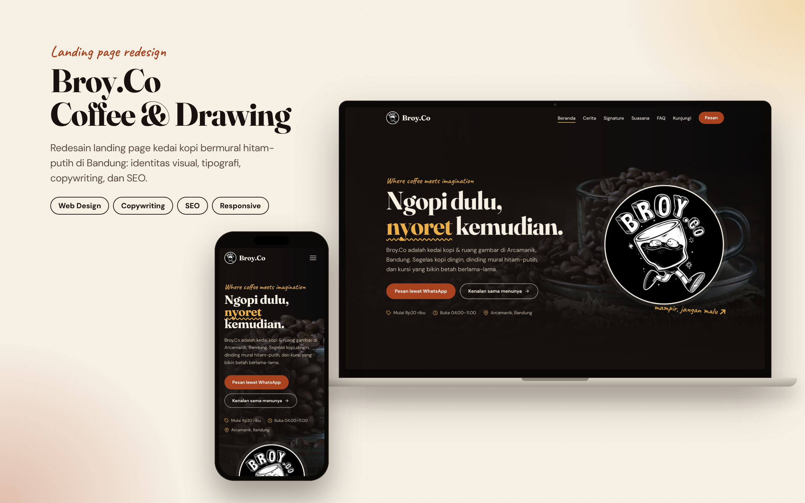
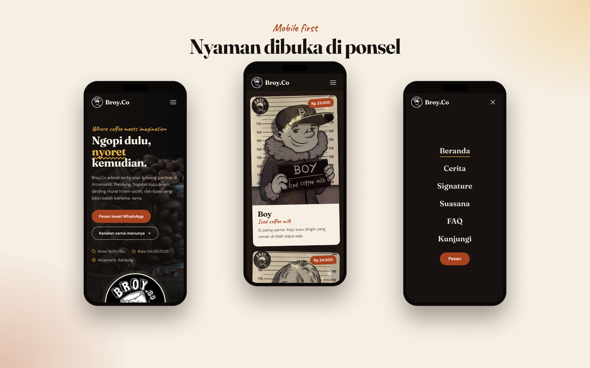
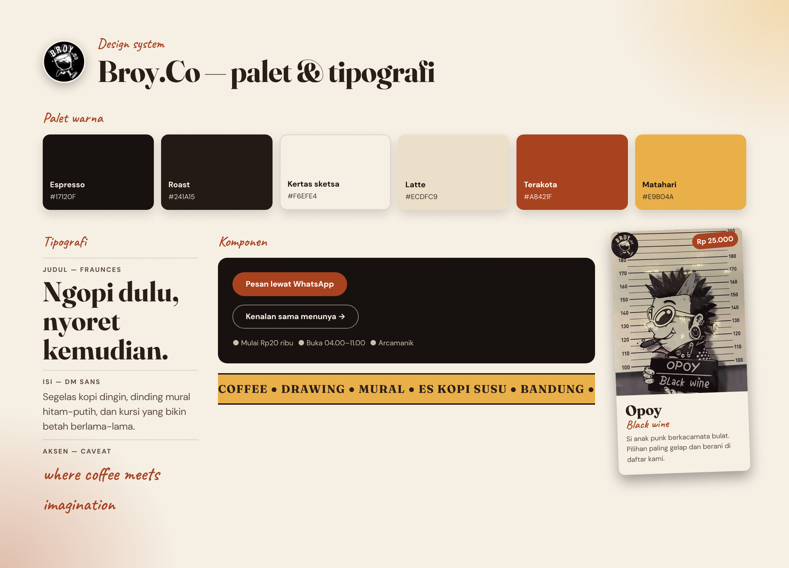
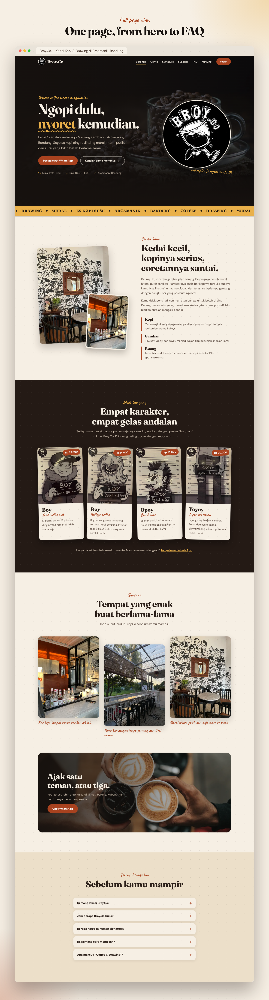

# Broy.Co — Landing Page Redesign

**Type:** Web design & front-end development · **Client:** Broy.Co (Coffee & Drawing), a coffee shop in Arcamanik, Bandung, Indonesia
**Scope:** Visual identity, typography, copywriting, SEO, responsive front-end
**Stack:** HTML5, CSS3 (custom properties, grid, flexbox), vanilla JavaScript, Google Fonts

---

## Overview

Broy.Co is a small coffee shop with a strong illustrated identity: black-and-white murals, a running-glass mascot, and "mugshot"-style character posters for each signature drink. The original landing page did not reflect that personality. It used generic stock photos, Lorem ipsum text, a placeholder blog, and a newsletter form that did nothing.

I redesigned the page from scratch so that it looks like the shop, reads like a real business website, and can be found on Google.

## The Problem

- The design was generic and did not match the brand's hand-drawn character.
- Content was placeholder text, so visitors got no real information (menu, hours, location).
- The "Order Now" button pointed to the staff/admin login of the shop's cashier app, not to something a customer could use.
- Poor SEO foundations: no meta description, no structured data, no semantic structure.
- Heavy, unoptimized photos (3–27 MB each) hurt loading speed, especially on mobile.

## The Solution

### Visual identity & typography
- **Palette** taken from the real shop: espresso and roast browns, sketch-paper cream, terracotta (the brick wall), and a warm sun yellow as accent. Text colors were chosen for readable contrast on both light and dark sections.
- **Type system:** *Fraunces* for characterful headings, *DM Sans* for readable body text, and *Caveat* for hand-written accents that echo the "coffee & drawing" theme.
- Small details that reinforce the theme: a wavy hand-drawn underline on the hero headline, slightly tilted drink cards, a halftone dot pattern, and a scrolling marquee strip.

### Content
- Rewritten in Indonesian for the local audience, with a playful hero line: *"Ngopi dulu, nyoret kemudian."* ("Coffee first, doodle after.")
- New sections: Story, Signature drinks (Boy, Roy, Opoy, Yoyoy with prices), real photos of the shop, FAQ, and a Visit section with address, opening hours, WhatsApp, Instagram, and map.
- The primary call to action is now **WhatsApp ordering**; the staff login moved to a small footer link.
- Removed everything fake: Lorem ipsum, dummy blog posts, stock photos, a dead newsletter form, and a placeholder email address.

### SEO
- Optimized title and meta description, canonical URL, Open Graph and Twitter Card tags with a generated share image.
- **Structured data (JSON-LD):** `CafeOrCoffeeShop` (address, hours, phone, price range, menu items with prices) and `FAQPage`.
- Semantic landmarks, a single `<h1>`, a logical heading order, descriptive `alt` text, and explicit image dimensions to avoid layout shift.
- `robots.txt` (keeps the internal cashier app out of search results), `sitemap.xml`, web manifest, and favicons.

### Performance
- Original photos (3–27 MB each) converted to responsive WebP/`srcset` variants; all variants together weigh about 1.4 MB.
- HTML + CSS + JS total about 50 KB. No frameworks and no icon-font dependency (icons are an inline SVG sprite).
- Lazy-loading for below-the-fold images, and a prioritized hero image.

### Accessibility & UX
- Skip link, visible focus states, keyboard-operable mobile menu (closes with Esc), `aria-expanded` state, and an accessible FAQ built with native `
`.
- Respects `prefers-reduced-motion`.
- Works without JavaScript: content and navigation remain usable; JS only adds the mobile overlay menu, scroll-spy, and reveal animations.

## Screens

### Mobile

### Design system

### Full page

## Verification

Checked in headless Chromium at 1440 px and 390 px widths: no horizontal overflow, no broken images, mobile menu and FAQ interactions work, all local assets and anchors resolve, and both JSON-LD blocks parse correctly. A Lighthouse audit and the embedded Google Map were not tested in my environment.

## Notes

- The shop's cashier/POS app (PHP + MySQL) lives in the same repository and was not modified in this project.
- Domain-dependent SEO tags currently use a placeholder domain and must be replaced at deployment.

## Tech Details

| Area | Details |
|---|---|
| Markup | Semantic HTML5, inline SVG icon sprite |
| Styling | Hand-written CSS with design tokens (custom properties), grid/flexbox, `clamp()` fluid type |
| Scripting | Vanilla JS: accessible nav, `IntersectionObserver` for scroll-spy and reveal |
| Assets | WebP with `srcset`, Open Graph image, favicons, web manifest |
| Tooling | Playwright (screenshots and checks), Python/Pillow (image optimization) |
